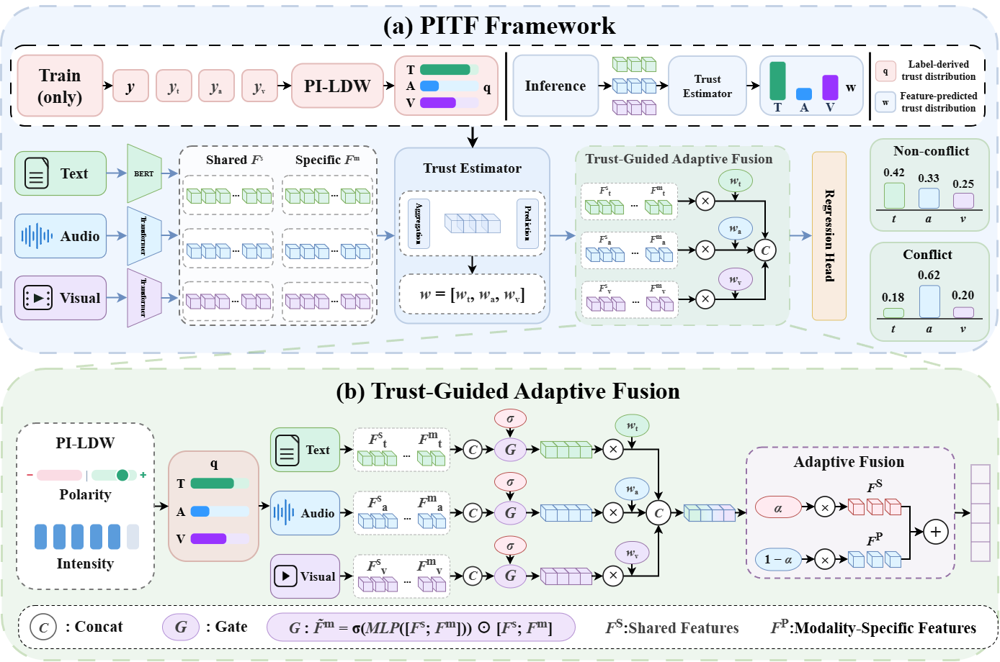

# Learning Modality Trust Beyond Label Distance in Multimodal Sentiment Analysis

In multimodal sentiment analysis (MSA), the degree of sentiment differences across modalities does not necessarily reflect their underlying semantic relationships. Conventional label-based modality trust supervision implicitly couples sentiment polarity and intensity, assigning equivalent supervisory signals to semantically distinct polarity conflicts and intensity variations. To address this issue, this paper reexamines modality trust modeling from the perspective of sentiment label semantics and proposes a Polarity–Intensity-aware Trust Fusion (PITF) framework. Specifically, Polarity–Intensity Label Divergence Weighting (PI-LDW) explicitly decouples sentiment polarity and intensity to construct semantically discriminative modality trust supervision, thereby guiding feature-driven modality trust learning and adaptive multimodal fusion. Through this design, PITF effectively translates sentiment relationships into dynamic fusion decisions without requiring sentiment labels during inference. Extensive experiments on five MSA datasets demonstrate that PITF achieves the highest binary classification accuracy among the compared methods on four benchmarks. Further experiments reveal the complementary roles of sentiment polarity and intensity in modality trust modeling and demonstrate the advantages of PI-LDW in sentiment prediction under cross-modal conflict conditions. Importantly, PI-LDW provides a parameter-free, plug-and-play supervision mechanism across different backbone architectures. These findings highlight the importance of distinguishing the semantic relationships underlying sentiment differences, rather than merely quantifying their magnitude, for effective modality trust learning.

## Architecture

Overview of the proposed PITF framework. (a) PITF consists of the following steps: First, PI-LDW decouples sentiment polarity and intensity differences between unimodal and overall sentiment labels to construct a semantically discriminative modality trust distribution during training. Second, text, audio, and visual features are extracted and projected into shared and modality-specific representations. Next, a trust estimator learns sample-level modality weights under the guidance of the supervisory distribution constructed by PI-LDW. Finally, the learned trust weights guide adaptive multimodal fusion and sentiment prediction, enabling the model to dynamically adjust modality contributions under different sentiment conflict conditions. During inference, modality trust is estimated directly from input features without requiring sentiment labels. (b) In the trust-guided adaptive multimodal fusion mechanism, shared and modality-specific representations are concatenated and refined through feature-level gating. The learned modality trust weights are then applied to regulate cross-modal feature aggregation, followed by adaptive fusion of shared and modality-specific representations to generate the final sentiment prediction.
## Installation

Use Python 3.10. Experiments used PyTorch 2.1.1 with CUDA 11.8. Use CUDA for full training. The CPU wheel can run unit tests, input checks, and small smoke runs.

```bash
conda create -n pitf python=3.10 -y
conda activate pitf
python -m pip install torch==2.1.1 --index-url https://download.pytorch.org/whl/cu118
python -m pip install -r requirements.txt
python -m pytest -q
```

## Data and BERT

Place the feature files at the paths below or edit `features`, `annotations`, and `bert` in `configs/*.json`. A relative path is resolved from the current working directory.

| Config | Dataset | Feature input | Data source |
| --- | --- | --- | --- |
| `sims.json` | CH-SIMS | `data/sims.pkl` from `unaligned_39.pkl` | [MMSA dataset instructions](https://github.com/thuiar/MMSA#datasets) |
| `simsv2.json` | CH-SIMS V2 | `data/simsv2.pkl` from the labeled release's unaligned feature set (`ch-sims2s/unaligned.pkl`) | [CH-SIMS V2 release](https://github.com/thuiar/ch-sims-v2#dataset) |
| `unic.json` | UniC | `data/unic.pkl` and `data/UniC_labels.csv` from the December 2025 feature and sentiment annotation release | [UniC release and access instructions](https://huggingface.co/datasets/LT3/UniC) |
| `mosi.json` | CMU-MOSI | `data/mosi.pkl` from MOSI `unaligned_50.pkl` | [MMSA dataset instructions](https://github.com/thuiar/MMSA#datasets) |
| `mosei.json` | CMU-MOSEI | `data/mosei.pkl` from MOSEI `unaligned_50.pkl` | [MMSA dataset instructions](https://github.com/thuiar/MMSA#datasets) |

Download the two BERT snapshots into the configured directories. [Chinese BERT](https://huggingface.co/google-bert/bert-base-chinese) · [English BERT](https://huggingface.co/google-bert/bert-base-uncased)

```bash
huggingface-cli download google-bert/bert-base-chinese config.json vocab.txt model.safetensors --local-dir pretrained/bert_cn
huggingface-cli download google-bert/bert-base-uncased config.json vocab.txt model.safetensors --local-dir pretrained/bert_en
```

Check the dataset and run PITF with seed 1.

```bash
python -m pi_ldw.cli --config configs/sims.json --output outputs/data-check/sims --stage check-data
python -m pi_ldw.cli --config configs/sims.json --output outputs/smoke/sims --seeds 1 --arms 111
```

For a shorter development run, reduce `encoder_epochs` and `max_epochs` in a copy of the config.

### CH-SIMS, CH-SIMS V2, and UniC

```bash
for dataset in sims simsv2 unic; do
  python -m pi_ldw.cli --config "configs/${dataset}.json" --output "outputs/pitf/${dataset}" \
    --arms 000 001 010 011 100 101 110 111 polarity_only intensity_only absolute
done
```

### CMU-MOSI and CMU-MOSEI

```bash
for dataset in mosi mosei; do
  python -m pi_ldw.cli --config "configs/${dataset}.json" --output "outputs/pitf/${dataset}" --arms 111
done
```

### Backbone transfer

```bash
for dataset in sims simsv2 unic; do
  python -m pi_ldw.transfer --config "configs/${dataset}.json" \
    --encoder-checkpoint "outputs/pitf/${dataset}/encoders/T/best.pt" \
    --output "outputs/transfer/${dataset}"
done
```

Transfer runs use frozen BERT token embeddings from the supervised text checkpoint and the dataset's audio/visual features. Baseline and +PI-LDW arms share the same backbone and data for a given dataset/seed. The added trust estimator rescales the three modality readouts before the prediction head. Use `--backbones transformer mult perceiver_io` or any subset.
